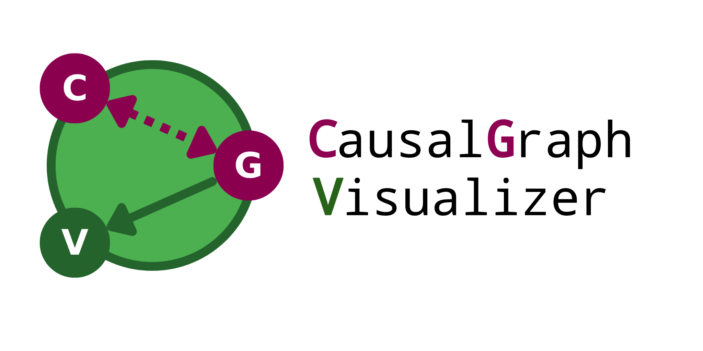
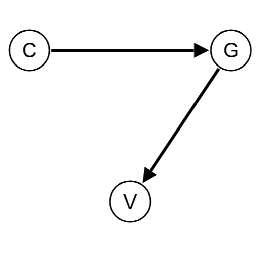
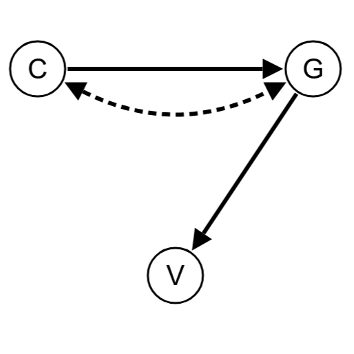
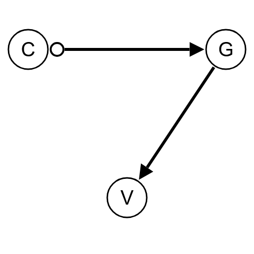

# Causal Graph Visualizer



An interactive tool for visualizing and editing causal graphs — available as both a **web application** and a **desktop application**.

---

## Try it Online

**[Launch Web App](https://causal-graph-visualizer-014f12.pages.imims.de/)**

---

## Download Desktop App

Download the latest version for your operating system from the [Releases](https://github.com/erikwhisper/causal-graph-visualizer/releases) page:

| Platform | File |
|----------|------|
| Windows | `.exe` files; the one with `Setup` in the name is the NSIS installer, the other `.exe` is portable |
| macOS | `.dmg` package; use the file with `-arm64` for Apple Silicon (M1-M4), and the file without that suffix for Intel Macs |
| Linux | `.AppImage`; if it does not start because `libfuse2` / `libfuse.so.2` is missing, run `chmod +x` on the file and start it with `--appimage-extract-and-run`, or install `libfuse2` |

---

## Features

- **Create & edit graphs** interactively, add nodes and directed edges with a few clicks or shortcuts
- **Import** CSV adjacency matrices (PAGs, ADMGs, and subsets) and JSON graph files (with full visualization metadata)
- **Export** as PDF, PNG (with DPI and transparency options), CSV matrix, or JSON graph
- **Edit node & edge properties**: colors, stroke widths, label fonts, arrowhead types, edge curvature, and more
- **Undo / Redo** functionality
- **Grid & snapping**: toggle an alignment grid and snap nodes/edges to it
- **Fit to Screen**: auto-centers and scales the graph to fill the canvas
- **Select All Nodes / Links**: quickly select everything for batch edits
- **Keyboard shortcuts** for efficient workflow (see table below)
- **Works offline** (desktop version)

---

## Graph Types Supported

| Type | Description | Example Files |
|------|-------------|---------------|
| **DAG** | Directed Acyclic Graph, standard causal model | [dag.csv](assets/examples/dag/dag.csv) · [dag.json](assets/examples/dag/dag.json) |
| **ADMG** | Acyclic Directed Mixed Graph, includes bidirected edges for latent confounders | [admg.csv](assets/examples/admg/admg.csv) · [admg.json](assets/examples/admg/admg.json) |
| **PAG** | Partial Ancestral Graph, represents equivalence classes with circle endpoints | [pag.csv](assets/examples/pag/pag.csv) · [pag.json](assets/examples/pag/pag.json) |

| DAG | ADMG | PAG |
| :---: | :---: | :---: |
|  |  |  |

---

## Quick Start

### Web App

1. Open the [web application](https://causal-graph-visualizer-014f12.pages.imims.de/)
2. Press **`Ctrl+Alt+N`** to add your first node
3. Hold **`Ctrl+Alt`** and click two nodes to connect them with a directed edge
4. Or import an existing file — see [File Formats](#file-formats) below

### Desktop App

1. Download the installer for your OS from [Releases](https://github.com/erikwhisper/causal-graph-visualizer/releases)
2. Install and launch — the app works fully offline
3. Same workflow as the web version

---

## Keyboard Shortcuts & Toolbar Buttons

On macOS, use **⌘** instead of `Ctrl` and **⌥** instead of `Alt`; Redo is `⌘⇧Z`, and `⌫` deletes the selection.

| Action | Button | Shortcut |
|--------|:------:|----------|
| Import CSV Matrix | ✓ | – |
| Import JSON Graph | ✓ | – |
| Undo | ✓ | `Ctrl+Z` |
| Redo | ✓ | `Ctrl+Y` |
| Add Node | ✓ | `Ctrl+Alt+N` — opens a popup to enter the node name |
| Add Edge | – | `Ctrl+Alt+Click` on two nodes in sequence |
| Select All Nodes | ✓ | `Ctrl+A` |
| Select All Edges | ✓ | `Ctrl+Shift+A` |
| Multi-select Nodes | – | `Ctrl+Click` or `Ctrl+Drag` on canvas |
| Multi-select Edges | – | `Ctrl+Click` or `Ctrl+Shift+Drag` on canvas |
| Delete Selection | ✓ | `Delete` |
| Toggle Grid & Snapping | ✓ | `Alt+G` |
| Fit to Screen | ✓ | `Ctrl+Shift+F` |
| Zoom | – | Mouse wheel or pinch |
| Pan | – | Drag on an empty part of the canvas |
| Export CSV Matrix | ✓ | – |
| Export JSON Graph | ✓ | – |
| Export PDF | ✓ | – |
| Export PNG | ✓ | — popup with DPI & transparency options |

---

## File Formats

### JSON Graph (`.json`)

Stores the full graph including all visual properties (positions, colors, fonts, curvature).
Recommended for saving and reopening work, and for sharing with collaborators.

### CSV Matrix (`.csv`)

Encodes the graph as an adjacency matrix. Useful for interoperability with causal discovery tools. The encoding follows the PAG convention of the R package [pcalg](https://cran.r-project.org/package=pcalg) (`amat.pag`), extended to support ADMGs as well.

**How to read it:** the entry in row *i*, column *j* is the **edge mark at the end of node *j*** of the edge between *i* and *j*. For example, `A → B` (tail at A, arrowhead at B) is stored as `2` in row A / column B and `3` in row B / column A.

| Value | Edge mark |
|:-----:|-----------|
| `0` | No edge |
| `1` | Circle (`o`) |
| `2` | Arrowhead (`>`) |
| `3` | Tail (`—`) |
| `4`, `5` | Only as a pair, see below (ADMG: directed + bidirected edge between the same nodes) |

**Accepted combinations** for a node pair *(i, j)*, given as *(row i / column j, row j / column i)*:

| Cells | Edge | | Cells | Edge |
|:-----:|------|-|:-----:|------|
| `0, 0` | no edge | | `1, 1` | *i* o–o *j* |
| `2, 3` | *i* → *j* | | `1, 2` | *i* ←o *j* |
| `3, 2` | *i* ← *j* | | `2, 1` | *i* o→ *j* |
| `2, 2` | *i* ↔ *j* | | `1, 3` | *i* –o *j* |
| `3, 3` | *i* — *j* | | `3, 1` | *i* o– *j* |
| `4, 5` | *i* → *j* and dashed *i* ↔ *j* | | `5, 4` | *i* ← *j* and dashed *i* ↔ *j* |

---

## Development

### Prerequisites

- [Node.js 22.12 or newer](https://nodejs.org/) (required by Electron 44; with older Node versions `npm install` finishes without an error, but the desktop app cannot start)
- npm

### Setup

```bash
git clone https://github.com/erikwhisper/causal-graph-visualizer.git
cd causal-graph-visualizer
npm install
```

### Commands

```bash
npm run dev             # Web development server (Vite)
npm run electron:dev    # Electron desktop app (dev mode, auto-opens window)
npm run build           # Build web version
npm run dist            # Build desktop installers
```

### Unsigned builds

The desktop builds are not code-signed, so your operating system may warn you on first start.

- **Windows:** if SmartScreen shows "Windows protected your PC", click **More info**, then **Run anyway**.
- **macOS:** if Gatekeeper refuses to open the app, right-click (or Ctrl-click) the app and choose **Open**. Alternatively, remove the quarantine flag in a terminal: `xattr -dr com.apple.quarantine "/Applications/Causal Graph Visualizer.app"`.

---

## License

Released under the [MIT License](LICENSE).
